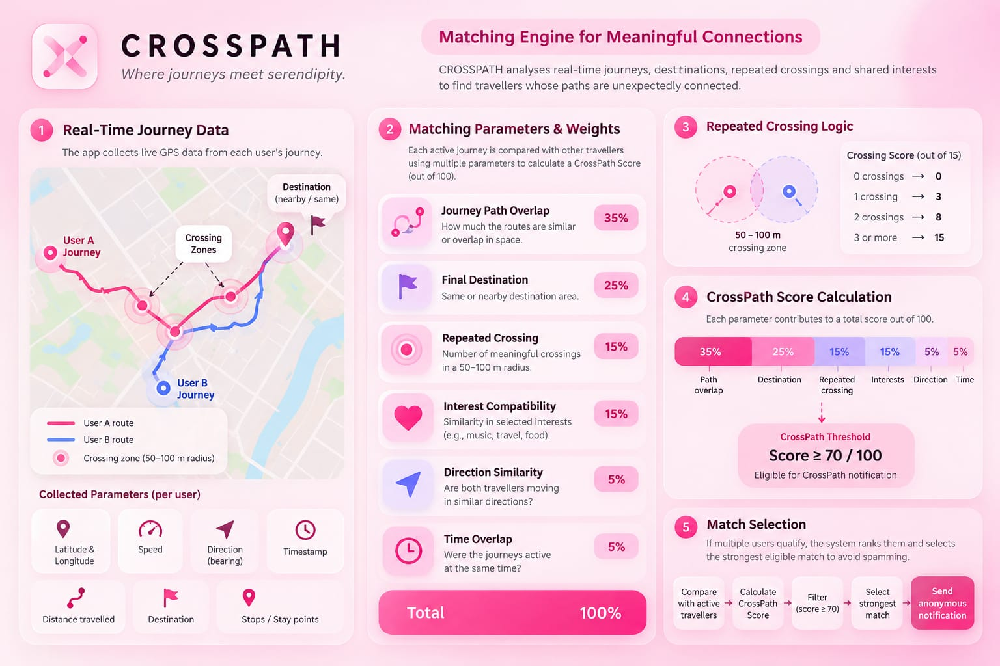
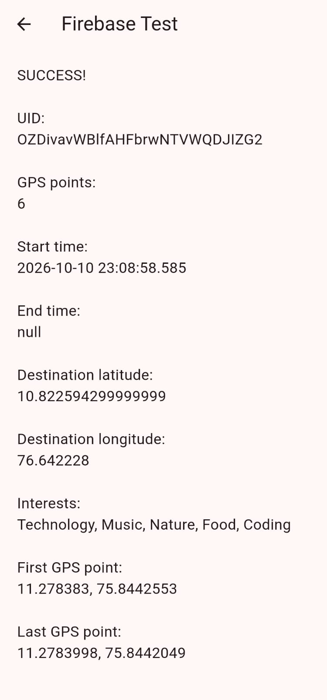
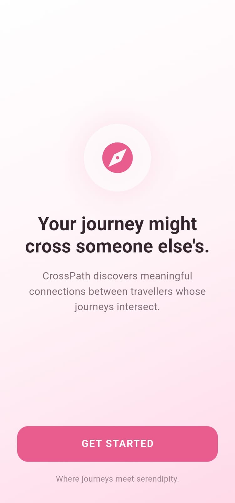
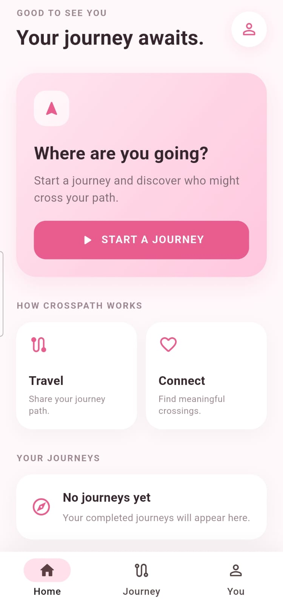
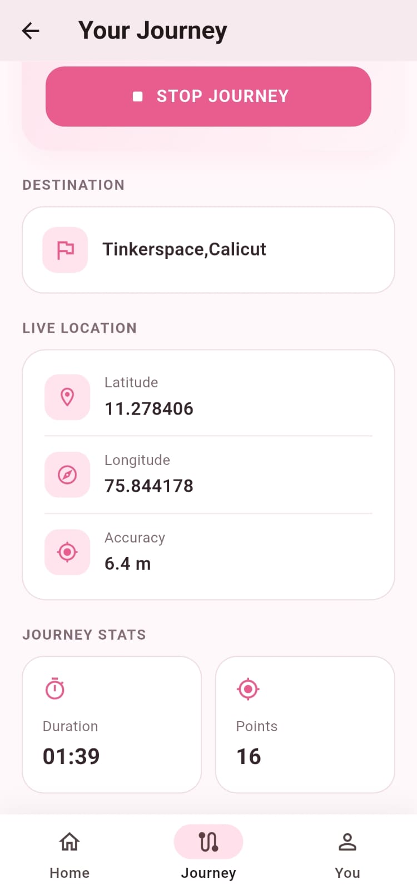
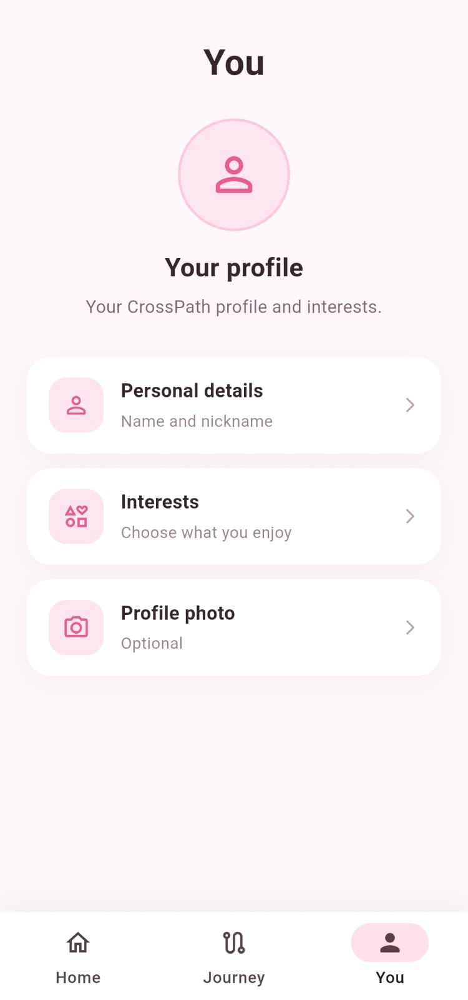
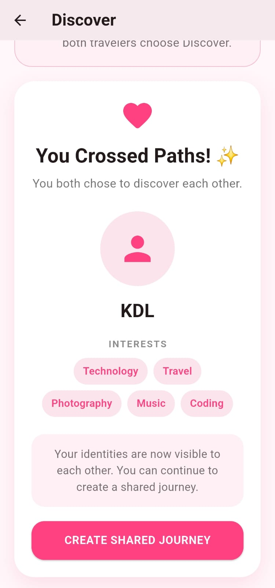
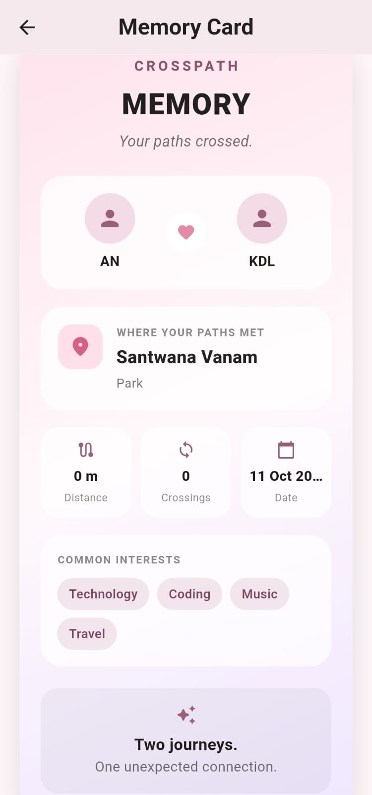

# CrossPath

### Where journeys meet serendipity.

CrossPath is a privacy-first journey matching application that discovers meaningful connections between travellers whose paths unexpectedly cross.

Instead of matching people only through static profiles, CrossPath analyses their **real-time journeys, destinations, repeated crossings, interests, direction and travel-time overlap** to calculate a deterministic CrossPath Score.

The goal is simple:

> **Two people may be strangers, but their journeys can reveal a meaningful connection.**

---

## ✨ What is CrossPath?

CrossPath tracks a user's journey using GPS and securely stores journey data in Firebase.

When multiple travellers are on the move, CrossPath compares their journeys using a weighted matching algorithm.

A user becomes eligible for a CrossPath connection when the calculated score reaches:

**70 / 100 or higher**

The system then provides an **anonymous discovery notification** rather than immediately revealing personal identity.

Identity is revealed only after **mutual discovery**.

---

# 🚀 Key Features

### 🔐 Authentication

- Username-based registration
- Firebase Authentication
- Secure user account creation
- Username uniqueness checking
- Persistent user profiles

### 👤 Profile

Users can configure:

- Name
- Interests
- Profile photo
- Discoverability

Profile information is stored in Firebase Firestore.

### 📍 Real-Time Journey Tracking

CrossPath collects:

- Latitude
- Longitude
- Timestamp
- Destination
- Destination coordinates
- Journey start time
- Journey end time
- Journey status

GPS points are continuously stored under the user's journey.

### 🗺️ Destination Detection

The destination entered by the user is converted into geographical coordinates using geocoding.

CrossPath then calculates the distance between the user's current location and destination.

A journey can automatically complete when the user reaches the destination radius.

### 🧠 Deterministic Matching Engine

CrossPath uses a transparent weighted scoring system rather than an opaque machine-learning model.

The total score is:

| Parameter | Weight |
|---|---:|
| Journey Path Overlap | 35% |
| Final Destination | 25% |
| Repeated Crossing | 15% |
| Interest Compatibility | 15% |
| Direction Similarity | 5% |
| Time Overlap | 5% |
| **Total** | **100%** |

A score of:

**≥ 70 → Eligible Match**

---

# 🧠 Matching Engine



The CrossPath matching engine compares two travellers using multiple independent parameters.

## 1. Journey Path Overlap — 35%

Measures how much the two travellers' routes overlap spatially.

GPS points from both journeys are compared using a defined proximity radius.

Higher route similarity produces a higher score.

---

## 2. Final Destination — 25%

The destinations of the two travellers are compared using their geographical coordinates.

Current scoring considers increasing distance between destinations:

- ≤ 1 km → 25 points
- ≤ 3 km → 20 points
- ≤ 5 km → 15 points
- ≤ 10 km → 8 points
- > 10 km → 0 points

---

## 3. Repeated Crossing — 15%

CrossPath detects meaningful crossings between two travellers.

A crossing is not counted repeatedly for every GPS update.

Instead, the system uses an entry/exit mechanism:

```text
Enter crossing zone
        ↓
Crossing detected
        ↓
Remain inside zone
        ↓
Exit crossing zone
        ↓
Re-enter zone
        ↓
New crossing
```

The crossing score is:

| Crossings | Score |
|---:|---:|
| 0 | 0 / 15 |
| 1 | 3 / 15 |
| 2 | 8 / 15 |
| 3+ | 15 / 15 |

The matching engine uses a **100 m route-overlap radius** and a hysteresis-based crossing detection approach to reduce GPS jitter.

---

## 4. Interest Compatibility — 15%

Users can select interests such as:

- Technology
- Music
- Nature
- Food
- Coding

The system compares the two interest sets using **Jaccard similarity**.

```text
Interest similarity =
Common interests / Total unique interests
```

The resulting similarity is converted into a maximum score of 15.

---

## 5. Direction Similarity — 5%

CrossPath calculates the approximate bearing of each journey.

Travellers moving in similar directions receive a higher score.

| Angular Difference | Score |
|---:|---:|
| ≤ 30° | 5 |
| ≤ 60° | 3 |
| ≤ 90° | 1 |
| > 90° | 0 |

---

## 6. Time Overlap — 5%

The system compares the active periods of two journeys.

If both travellers were travelling during the same period, the amount of temporal overlap contributes to the score.

The overlap is normalized relative to the shorter journey.

---

# 📊 CrossPath Score

The final score is calculated as:

```text
CrossPath Score =
    Route Overlap
  + Destination Similarity
  + Repeated Crossing
  + Interest Compatibility
  + Direction Similarity
  + Time Overlap
```

Maximum:

```text
100 points
```

Eligibility threshold:

```text
Score ≥ 70
```

This makes the matching process **deterministic, explainable and easy to demonstrate**.

---

# 🔄 Matching Flow

```text
              USER A
                │
                ▼
        Start GPS Journey
                │
                ▼
        Collect GPS Points
                │
                ▼
        Store Journey Data
                │
                │
                ▼
       ┌─────────────────┐
       │ Matching Engine  │
       └─────────────────┘
                ▲
                │
                │
        Store Journey Data
                │
                ▲
                │
        Collect GPS Points
                ▲
                │
        Start GPS Journey
                ▲
              USER B
```

The matching engine then:

```text
Compare active travellers
          ↓
Calculate CrossPath Score
          ↓
Filter score ≥ 70
          ↓
Rank eligible matches
          ↓
Select strongest match
          ↓
Send anonymous discovery
          ↓
Mutual Discover
          ↓
Identity revealed
```

---

# 🔒 Privacy by Design

Privacy is a core part of CrossPath.

Before mutual discovery:

- ❌ No name revealed
- ❌ No profile photo revealed
- ❌ No phone number revealed
- ❌ No exact live location revealed
- ❌ No direct identity exposure

Instead, users receive an anonymous indication that another traveller may have crossed their path.

Only when **both users independently choose Discover** is the connection revealed.

CrossPath is designed around the principle:

> **Match first. Reveal later.**

---

# ☁️ Firebase Architecture

CrossPath uses Firebase for authentication and real-time journey data.

## Firebase Authentication

Firebase Authentication handles user login and registration.

---

## Firestore Structure

The current journey structure is:

```text
users
│
├── {userId}
│   │
│   ├── name
│   ├── username
│   ├── interests
│   ├── photoUrl
│   ├── discoverable
│   ├── profileComplete
│   │
│   └── journeys
│       │
│       └── {journeyId}
│           ├── destination
│           ├── destinationLatitude
│           ├── destinationLongitude
│           ├── startTime
│           ├── endTime
│           ├── status
│           ├── createdAt
│           │
│           └── points
│               │
│               ├── {pointId}
│               │   ├── latitude
│               │   ├── longitude
│               │   ├── accuracy
│               │   └── timestamp
│
└── usernames
    └── {username}
```

---

# 📍 Real Firebase Journey Test

The Firebase integration has been tested using a real journey stored in Firestore.

The application successfully retrieves:

- Firebase UID
- Journey document
- GPS points
- Start time
- Destination latitude
- Destination longitude
- User interests
- First GPS point
- Last GPS point

Example test result:

```text
SUCCESS!

GPS points: 6

Destination latitude:
10.82259429999999

Destination longitude:
76.642228

Interests:
Technology, Music, Nature, Food, Coding
```

This confirms that the Firebase journey data can be converted into the internal `JourneyData` model used by the matching engine.



---

# 🧪 Matching Engine Testing

The matching engine has been tested independently using controlled journey data.

## Positive Match Test

Example result:

```text
========================================
       CROSSPATH MATCHING TEST
========================================
Route Score:       35.00 / 35
Destination Score: 25.00 / 25
Crossing Score:    3.00 / 15
Interest Score:    7.50 / 15
Direction Score:   5.00 / 5
Time Score:        5.00 / 5
----------------------------------------
TOTAL SCORE:       80.50 / 100
MATCH:             YES
========================================
```

### Result

```text
80.50 / 100
```

Since:

```text
80.50 ≥ 70
```

the travellers qualify as a CrossPath match.

---

## Negative Match Test

A second test was performed with incompatible journeys:

```text
========================================
       CROSSPATH NON-MATCH TEST
========================================
Route Score:       0.00 / 35
Destination Score: 0.00 / 25
Crossing Score:    0.00 / 15
Interest Score:    0.00 / 15
Direction Score:   5.00 / 5
Time Score:        0.00 / 5
----------------------------------------
TOTAL SCORE:       5.00 / 100
MATCH:             NO
========================================
```

Result:

```text
5.00 / 100
```

Therefore:

```text
5.00 < 70
```

and the travellers are not considered a match.

---

# 📱 Application Screens

CrossPath includes a complete journey-to-connection flow, from authentication and GPS tracking to mutual discovery, real-world meetup verification and memory creation.

---

## 🌸 Splash Screen



The splash screen introduces the CrossPath concept:

> Your journey might cross someone else's.

---

## 🏠 Home Screen



The Home screen provides access to:

- Start a new journey
- Journey status
- CrossPath matching
- Profile
- Memory Card
- Previous journey information

---

## 📍 Journey Tracking



The Journey screen provides real-time journey tracking using GPS.

Features include:

- Destination selection
- GPS permission handling
- Live location tracking
- Journey timer
- GPS point collection
- Destination coordinate detection
- Automatic destination arrival detection
- Journey completion
- Firestore journey storage

---

## 👤 Profile



The profile screen allows users to manage:

- Name
- Interests
- Discoverability
- Profile information

User data is stored using Firebase Firestore.

---

## 💗 Mutual Discovery



When CrossPath identifies a potential connection, the user receives an anonymous discovery.

The identity of the other traveller remains hidden initially.

Only when **both travellers independently choose Discover** does CrossPath reveal the connection.

The revealed profile includes:

- Traveller name
- Shared interests
- Connection information
- Option to create a Shared Journey

---

## 🤝 Real-World Meetup Verification


After both travellers agree to create a Shared Journey, CrossPath suggests a public meeting location.

The application then performs real-time GPS verification.

The meetup is considered successful when the two travellers' current GPS coordinates are within approximately **100 metres** of each other.

This creates a real-world confirmation that the two CrossPath journeys have actually connected.

---

## 💌 CrossPath Memory Card



After a successful connection, CrossPath creates a Memory Card containing the connection details.

The card includes:

- Both traveller names
- Meeting location
- Meeting place type
- Date
- Common interests
- Journey connection information

The Memory Card provides a simple visual record of the moment when two journeys crossed.

# 🏗️ Project Structure

```text
crosspath/
│
├── android/
│
├── lib/
│   │
│   ├── screens/
│   │   ├── splash_screen.dart
│   │   ├── welcome_screen.dart
│   │   ├── login_screen.dart
│   │   ├── register_screen.dart
│   │   ├── home_screen.dart
│   │   ├── profile_setup_screen.dart
│   │   ├── profile_screen.dart
│   │   ├── destination_screen.dart
│   │   ├── journey_screen.dart
│   │   ├── discover_match_screen.dart
│   │   ├── shared_journey_screen.dart
│   │   ├── memory_card_screen.dart
│   │   └── firebase_test_screen.dart
│   │
│   ├── services/
│   │   ├── auth_service.dart
│   │   ├── matching_service.dart
│   │   ├── journey_data_service.dart
│   │   ├── discover_service.dart
│   │   └── active_match_service.dart
│   │
│   ├── firebase_options.dart
│   └── main.dart
│
├── test/
│   └── matching_service_test.dart
│
├── docs/
│   └── screenshots/
│       ├── discover.jpeg
│       ├── firebase_test.jpeg
│       ├── home_screen.jpeg
│       ├── journey_screen.jpeg
│       ├── matching-engine.jpeg
│       ├── meetup_success.jpeg
│       ├── memory_card.jpeg
│       ├── profile_screen.jpeg
│       └── splash_screen.jpeg
│
├── pubspec.yaml
└── README.md


# 🛠️ Technologies Used

| Technology | Purpose |
|---|---|
| Flutter | Cross-platform mobile application |
| Dart | Application programming language |
| Firebase Authentication | User authentication |
| Cloud Firestore | User and journey data |
| Geolocator | GPS location tracking |
| Geocoding | Destination-to-coordinate conversion |
| Material 3 | Application UI |
| Git / GitHub | Version control |

---

# 📦 Main Dependencies

```yaml
firebase_core
firebase_auth
cloud_firestore
geolocator
geocoding
```

---

# ⚙️ Getting Started

## Prerequisites

Install:

- Flutter SDK
- Android Studio
- Android SDK
- Git
- A Firebase project
- Android device or emulator

---

## Clone the repository

```bash
git clone <YOUR_REPOSITORY_URL>
cd crosspath
```

---

## Install dependencies

```bash
flutter pub get
```

---

## Configure Firebase

Configure Firebase for the Flutter application using FlutterFire.

The generated Firebase configuration is stored in:

```text
lib/firebase_options.dart
```

Enable:

- Firebase Authentication
- Email/Password authentication
- Cloud Firestore

---

## Run the application

Connect an Android device or start an emulator and run:

```bash
flutter run
```

---

# 🔐 Firestore Security

CrossPath uses authenticated access for user data.

The application currently restricts users from directly modifying other users' profile documents.

Nested journey and matching access should remain carefully controlled as the application moves toward the final privacy-preserving matching architecture.

---

# 🧩 Current Development Status

### ✅ Completed

- [x] Flutter project setup
- [x] Firebase integration
- [x] Firebase Authentication
- [x] Username-based registration
- [x] Login
- [x] Profile setup
- [x] Firebase-backed profile display
- [x] GPS permission handling
- [x] Real-time GPS journey tracking
- [x] Destination geocoding
- [x] Destination coordinates stored in Firestore
- [x] Automatic destination distance calculation
- [x] Journey completion logic
- [x] Single active journey architecture
- [x] GPS points stored in Firestore
- [x] JourneyDataService
- [x] Deterministic CrossPath matching engine
- [x] Route overlap scoring
- [x] Destination scoring
- [x] Repeated crossing detection
- [x] Interest compatibility scoring
- [x] Direction scoring
- [x] Time overlap scoring
- [x] 70/100 match threshold
- [x] Positive matching test
- [x] Negative matching test
- [x] Real Firebase journey-data test
- [x] Candidate traveller discovery
- [x] Anonymous match notification
- [x] Mutual Discover mechanism
- [x] Identity reveal after mutual consent
- [x] Shared Journey creation
- [x] Public meeting-place recommendation
- [x] Real-time meetup GPS verification
- [x] 100 m meetup proximity verification
- [x] Meetup success confirmation
- [x] CrossPath Memory Card
- [x] Firestore-backed connection data

# 🌟 Future Vision

CrossPath can evolve beyond simple journey matching into a platform for discovering meaningful human connections through shared movement.

Future versions could include:

- Combined journey navigation
- Interactive route maps
- Saved journey history
- Rich journey visualizations
- Travel communities
- Event-based journey matching
- Smart route recommendations
- Privacy-preserving matching infrastructure
- Cloud-based profile photos
- CrossPath connection history

# 💡 Why CrossPath?

Most social applications start with:

```text
Who are you?
What are your interests?
```

CrossPath starts with:

```text
Where are you going?
Where have your paths crossed?
What do you have in common?
```

The journey becomes the connection.

---

## ❤️ CrossPath

### Where journeys meet serendipity.
